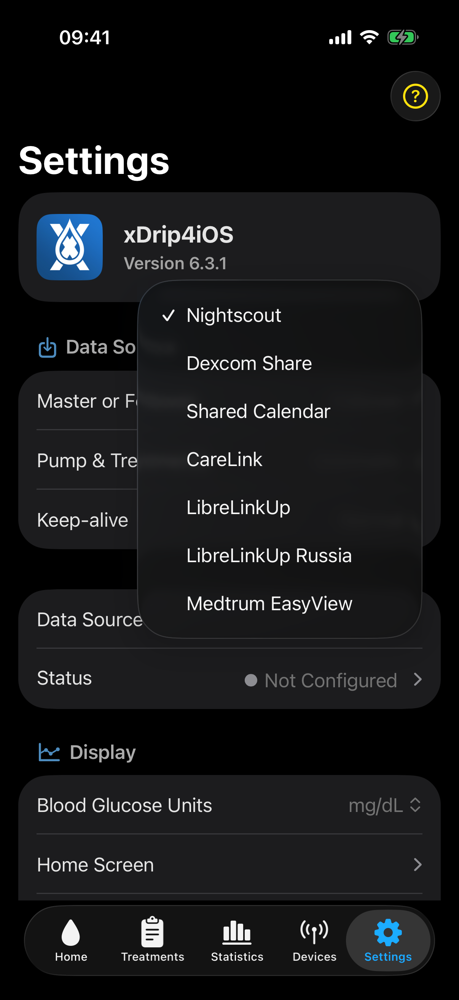

# Follower mode

Follower mode receives glucose readings from an online source instead of a directly connected CGM.

## Configure follower mode

Under **Settings > Data Source**, select **Follower**. Select the required service from **Data Source**, then select **Status** to open its settings. Enter the required account, site, or shared calendar details. Return to **Home** and wait for a current reading.

Changing to Follower mode stops the current direct sensor in xDrip4iOS and removes its CGM device. Confirm the change only when you intend to stop the direct connection on this device.

## Available follower sources

- [Nightscout](nightscoutFollower.md)
- [LibreLinkUp and LibreLinkUp Russia](libreLinkUp.md)
- [Dexcom Share](dexcomShareFollower.md)
- [Shared Calendar](sharedCalendar.md)
- [CareLink](careLink.md)
- [Medtrum EasyView](medtrumEasyView.md)

## Service settings

Each follower service has its own settings screen. Depending on the service, it can contain account details, login controls, patient selection, connection information, sensor information, and service availability.

The optional **Alias** is available in the Profile section for Nightscout, Dexcom Share, LibreLinkUp, and Medtrum EasyView. Shared Calendar receives the alias from the source device. CareLink uses the selected CareLink patient.

## Background updates

Under **Settings > Data Source**, use **Keep-alive** to select how xDrip4iOS should try to update readings while it is in the background:

- **Disabled** uses no additional method to request background updates.
- **Normal** performs standard background update work.
- **Aggressive** requests more frequent background opportunities and can use more battery.
- **Continuous** plays silent audio continuously while the app is in the background. It has the highest battery use and should only be used in extreme cases when Normal and Aggressive do not work reliably enough.
- **Heartbeat** uses a configured Bluetooth heartbeat device.

Start with Normal. Try Aggressive only if Normal does not provide reliable background updates. Use Continuous only if both of those options do not work well enough. iOS still decides whether an app can remain active, so Continuous cannot guarantee an exact download time.

Selecting **Shared Calendar** changes Disabled to Normal when needed.

## Pump and treatment information

**Pump & Treatments** selects where xDrip4iOS receives online pump and treatment information. **Automatic** uses the service that fits the current configuration. Nightscout can provide treatments and AID information. CareLink can provide pump and treatment information when CareLink is also the glucose source. Select **None** to stop online pump and treatment imports.

## Optional Nightscout upload

A Follower can upload downloaded readings to a separate Nightscout site. Do not upload them back to the same site from which they were downloaded. Test the Follower source before enabling Nightscout upload.
