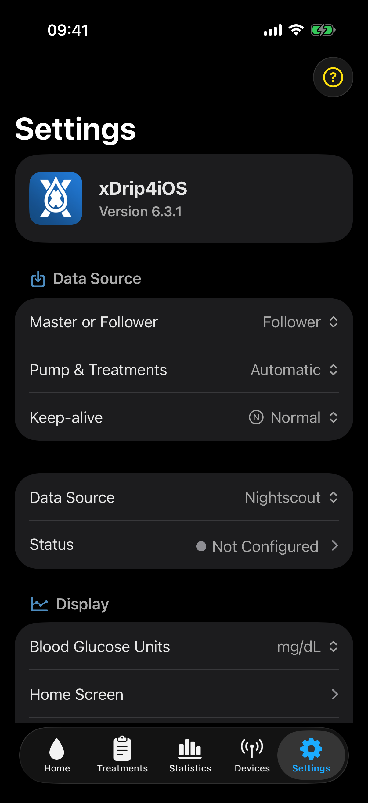

# Choose a data source

The data source determines where xDrip4iOS obtains glucose readings.

## Use Master mode when

- this device should connect directly to a supported Dexcom, Libre, or Medtrum device
- you want xDrip4iOS to receive readings without first downloading them from a cloud service.

Only one CGM device can be active. Display devices and heartbeat devices are separate groups in the **Devices** tab.

## Use Follower mode when

- the readings already exist in Nightscout
- another app uploads readings to LibreLinkUp or Dexcom Share
- another person shares readings through Calendar Share
- the user has a Medtrum EasyView account
- readings are available through a CareLink account
- this device is used by a parent, partner, or caregiver.

Follower mode needs internet access. Select a **Keep-alive** option to help xDrip4iOS check for new readings in the background. iOS background limits can delay downloads when the app is not open. Review [Permissions and background operation](permissions.md).

## Configure Follower mode

Under **Settings > Data Source**, select **Follower**. Select the required service from **Data Source**, then select **Status** to open its settings.

The main screen also contains **Pump & Treatments**. Leave this set to **Automatic** unless you need to prevent online pump and treatment imports or select a different configured service.

**Status** opens the settings for the selected follower source. Use that screen to enter the account, site, or calendar details and to check the latest connection activity. A connected status confirms that xDrip4iOS can reach the source. Always check the glucose timestamp as well because a working source can still contain an old reading.

## Background updates in Follower mode

**Keep-alive** controls how xDrip4iOS tries to check the follower source while the app is in the background.

- Start with **Normal**.
- Try **Aggressive** if Normal is not reliable enough.
- Use **Continuous** only in extreme cases when both Normal and Aggressive do not work well enough. It plays silent audio continuously and has the highest battery use.
- Use **Heartbeat** only with a separately configured Bluetooth heartbeat device.

iOS controls background operation, so no option can guarantee that every reading or alarm arrives at an exact time. See [Follower mode](../connect/follower.md#background-updates) for the full explanation.

## Direct and cloud paths are different

A sensor can work through a Follower service even when xDrip4iOS cannot connect to it directly. For example, xDrip4iOS can download Libre 3 readings from LibreLinkUp, but it cannot connect directly to a Libre 3 sensor.

If you use CamAPS, the sensor determines whether xDrip4iOS can receive readings at the same time. Supported Dexcom sensors can work with both apps. Libre 2 and Libre 3 sensors cannot provide direct readings to xDrip4iOS while CamAPS is using them. See [Using xDrip4iOS with CamAPS](../connect/camAPS.md).
