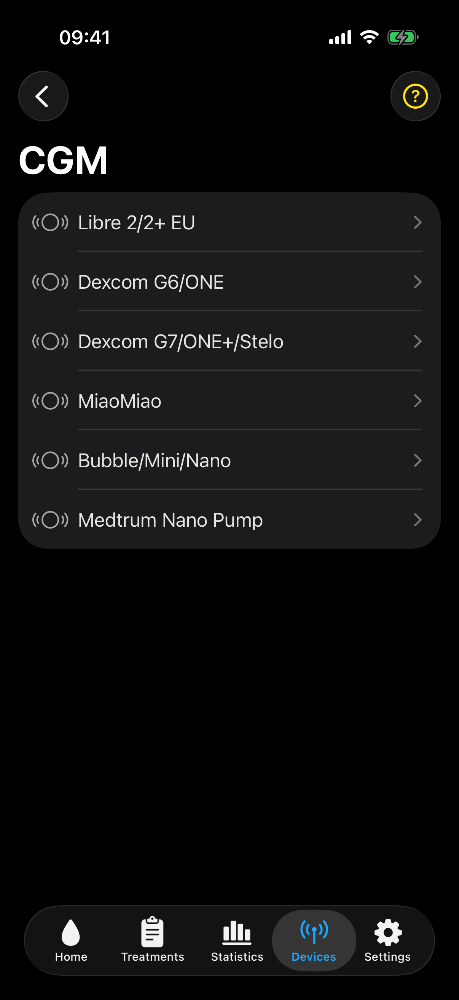

# Devices

The Devices tab manages CGM, Follower Heartbeat, and M5Stack devices.

## Device categories

- **CGM** devices provide direct glucose data in Master mode.
- **Follower Heartbeat** devices can help Follower mode check for readings in the background. They do not provide glucose.
- **M5Stack** devices receive glucose display data from xDrip4iOS.

The screen groups saved devices by category and shows their type, connection state, and ID or name.

## Add a device

Select the add button, select a category, and then select the device family. xDrip4iOS then shows the setup fields and actions for that device.

The **CGM** category lists the direct CGM families supported by xDrip4iOS. Before scanning for Libre 2, Dexcom, or Medtrum Nano Pump, the app shows the connection requirement for that system. Read and complete it before selecting **Scan**.

## Device information

Select a configured device in the **Devices** tab. The page for that device always shows its connection and a connect or disconnect action. It can also include:

- name or alias
- transmitter ID
- battery information
- sensor details
- Dexcom connection mode and Bluetooth channel
- Bluetooth signal strength
- the percentage of expected readings received
- Libre calibration options
- device-specific M5Stack controls
- a delete control.

An unavailable control can indicate that the device is connected, that another CGM is active, that an NFC scan is required, or that the selected family does not support the function.

Compatible heartbeat and display devices can show a battery level. The row is hidden when the device does not provide a supported value.

## Signal Strength

Select **Signal Strength** on a device screen to check the Bluetooth reception measured by the iPhone. The value is shown in dBm with a scale from weak to strong.

Devices that stay connected show a live chart for the last two minutes. New measurements are added about once per second while the screen is open and the device is connected.

Dexcom devices connect only briefly for each reading. Their screen shows the latest measurement and its age instead of a continuous chart.

Use this screen when checking the effect of distance, body position, a case, or nearby interference. Signal strength can help explain a Bluetooth problem, but it does not show whether a glucose value is accurate.

## Battery History

Supported devices save genuine battery readings and provide a **Battery History** chart.

- For Dexcom G6 and G7-family devices, select **Voltage B**.
- For a compatible heartbeat, MiaoMiao, Bubble, or M5Stack device, select its battery value when the row shows a disclosure arrow.

The available range depends on how long battery readings have been stored. It can include 3, 7, or 12 days and the recorded device lifetime. Gaps show periods when no battery value was received.

For a newly added device, the chart can show **No battery history** until the next genuine battery reading arrives. A battery symbol is a quick status indicator. Open the chart to review the change over time.

## Connection status and wait time

The device list and device information page distinguish these states:

- **Not Scanning** means that the device is not active.
- **Scanning** means that xDrip4iOS is searching for a new device.
- **Connecting** means that the device is active but has not yet completed its first connection.
- **Connected** means that Bluetooth is connected at that moment.
- **Waiting...** is the normal green state for a Dexcom device between readings after it has connected successfully.
- **Reconnecting** means that a continuously connected device has unexpectedly disconnected and xDrip4iOS is trying to restore it.

**Scanning**, **Connecting**, **Waiting...**, and **Reconnecting** show a clock and the elapsed time. For a Dexcom device, the **Waiting...** timer normally restarts after each brief connection. Check the glucose reading time if the wait becomes longer than the normal reading interval.

The connection timer was proposed by Dana Lewis and adapted for xDrip4iOS.

## Percentage of readings received

For a compatible CGM, select the device in the **Devices** tab and open **Read Success**. It shows the percentage and number of expected readings received during the last 24 hours. The hourly chart shows when the gaps occurred. Use it to distinguish an occasional gap from a repeated connection problem. The expected number is based on the normal reading interval observed for that transmitter.

## Delete a device

Deleting removes the device from xDrip4iOS. It does not stop the physical sensor or delete data from an online service.
