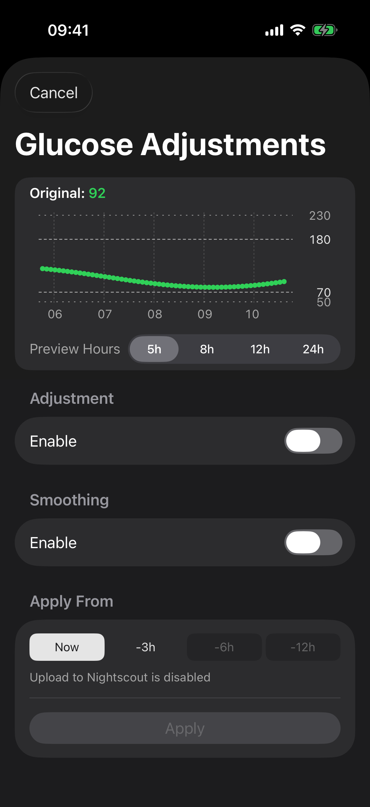

# Glucose Adjustments

Glucose Adjustments can change or smooth the values shown by xDrip4iOS. The original readings remain stored.

!!! warning "xDrip4iOS values will be different"
    If xDrip4iOS uses a Dexcom sensor in **Coexistence Mode** or receives readings in **Follower** mode, it receives glucose values from another app or service. Enabling **Adjustment** or **Smoothing** changes the values displayed by xDrip4iOS. The values in xDrip4iOS will then differ from the original data source. This is expected.

    Disable both **Adjustment** and **Smoothing** if xDrip4iOS should display the original values. You can also enable **Show Original Glucose Readings** to compare the original and changed values.

    **OS-AID Share** sends unsmoothed data unless **Share Smoothed Data** is enabled. See [Glucose Adjustments and shared values](../services/osAidShare.md#glucose-adjustments-and-shared-values).

Select **Glucose Adjustments** in the toolbar at the top of **Home**. Choose the number of hours shown in the preview chart before changing the settings.

## Adjustment

Enable **Adjustment**, then use **Offset** and **Scale** to change eligible readings. **Emphasis** selects where Scale has the most effect:

- **Normal** applies the effect evenly through the glucose range.
- **Highs** applies more of the effect at higher values.
- **Lows** applies more of the effect at lower values.

Use recent blood glucose checks when setting an adjustment. The preview shows the original value and the result of the selected settings.

## Smoothing

Enable **Smoothing**, then select Light, Medium, or Strong. Select an **Algorithm**:

- **Savitzky-Golay** is the default. It smooths short sections while keeping the general shape of peaks and troughs.
- **Exponential** calms recent changes with less flattening.
- **Kalman** produces a steadier curve with more visible filtering.
- **LOESS** follows ramps and bends with a less rigid curve.
- **Hampel + Savitzky-Golay** first reduces isolated spikes, then smooths the wider curve.

Preview the result before applying it.

Smoothing can hide a real rapid change or make the chart appear delayed.

## Reading frequency

Some sources provide readings more often than every five minutes. When **Reading Frequency** is shown, enable **5-minute readings** to use one visible reading approximately every five minutes. Nightscout and Apple Health have separate options for storing the extra readings.

## Apply the changes

Under **Apply From**, select **Now** or an available period of recent history, then select **Apply**. Applying to a previous period replaces the displayed values for that period. Read any message below the selection because it states whether Nightscout or Dexcom Share data will also be updated.

## Original readings

Enable original readings in **Quick Show/Hide** or under **Settings > Glucose Display > Home Screen** to compare them with the adjusted readings. You can also compare both values in **Glucose Readings**.

When adjustments are active, press and hold the Glucose Adjustments button on **Home** to show the original readings temporarily.

!!! warning
    Glucose Adjustments change the values shown by xDrip4iOS. They cannot correct a faulty sensor. Keep original readings visible while testing a change and confirm doubtful values with an approved meter.
