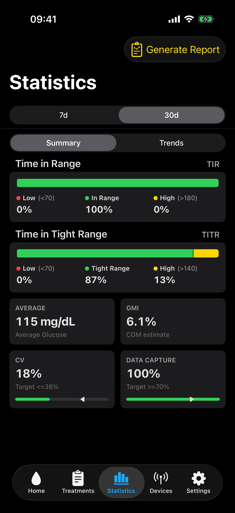
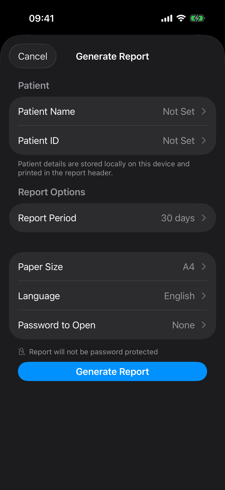
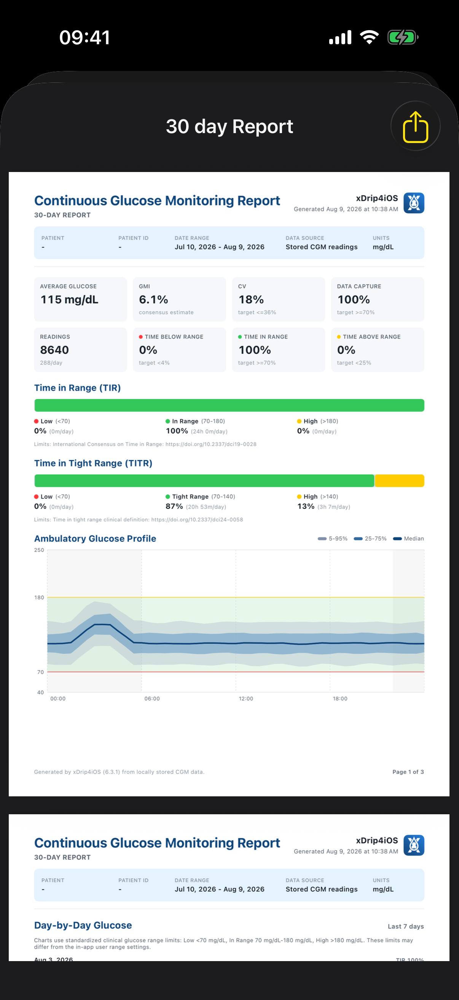

# Statistics

The **Statistics** tab turns stored glucose readings into a longer-term overview. Use it to look for repeated patterns, compare different periods, and prepare a PDF report to review with a healthcare professional.

Statistics are based on readings stored on this device. Missing readings, deleted history, a recent installation, or an interrupted follower connection can make the results less complete.

On wider iPad windows, related statistics and trend charts can appear beside each other. The selected period, calculations, and report contents are the same as on iPhone.

## Choose a period

Select the period at the top of the screen. The available choices are 7, 30, 60, 90, 180, and 365 days.

A period is only available when enough readings are stored for a useful result. This prevents a small amount of data from being presented as a complete view of the selected period.

The Statistics tab and PDF reports use standard clinical ranges:

- Time in Range is 70 to 180 mg/dL, or 3.9 to 10.0 mmol/L
- Time in Tight Range is 70 to 140 mg/dL, or 3.9 to 7.8 mmol/L.

These ranges can be different from the personal glucose ranges configured for the **Home** screen and alerts.

## Summary

**Summary** gives a quick view of glucose results for the selected period.

- **Time in Range** shows the percentage of readings below, within, and above the standard range.
- **Time in Tight Range** uses the narrower upper limit of 140 mg/dL or 7.8 mmol/L.
- **Average** shows the average of the stored readings.
- **GMI** or **Estimated HbA1c** estimates a value from the average CGM glucose. Select the estimate under **Settings > General > Statistics > Glucose Estimate**. Neither value is a laboratory HbA1c result.
- **CV** shows how much glucose values vary. A lower value normally means that glucose has been more stable.
- **Data Capture** shows how much of the expected CGM history is available. The calculation expects one reading every five minutes.

The target markers beside CV and Data Capture provide a simple reference. They do not replace personal targets agreed with a healthcare professional.

## Trends

**Trends** helps show when patterns repeat and how results have changed during the selected period.

The **Ambulatory Glucose Profile** combines readings from many days into one 24-hour chart. The middle line shows the usual glucose value at each time of day. The shaded areas show how widely readings varied. This can make repeated overnight, morning, afternoon, or evening patterns easier to see.

The trend charts show changes in the selected glucose estimate and CV over time. The estimate chart uses the selected unit and identifies the interval represented by each point. It uses daily points for 7 days, 3-day points for 30 days, and weekly points for longer periods.

When compatible Nightscout or CareLink treatment history is available, the trends can also show changes in average total daily insulin and average carbohydrates. CareLink total daily insulin includes recorded boluses and automatic basal deliveries.

The **Daily Pattern** shows the percentage in the selected clinical range for each day. The average for the selected period appears beside the section title. The dashed line marks the 70% clinical target.

Statistics describe stored history. They do not predict the next glucose value.

## Create a PDF report

Select **Generate Report** at the top of **Statistics**.

The report provides a clear, portable summary of the selected period. It is useful when preparing for an appointment, discussing recurring glucose patterns, or keeping a copy of results from a defined period. It is designed for review and sharing. It is not a live glucose display and should not be used to make an immediate treatment decision.

The app recommends a 90-day report for a broad review. Choose a shorter period when the purpose is to review a recent change or a specific period. Longer periods are also available when enough readings are stored.

Choose:

- **Patient Name** and **Patient ID**, if required
- **Report Period**
- **Paper Size**
- **Language**
- **Password to Open**, if the PDF needs protection.

Select **Generate Report** to create the PDF. The report uses the GMI unit selected when generation starts. Review the preview, then use the share button to save, print, or send it.

PDF reports always use GMI. Selecting Estimated HbA1c for the Home and Statistics displays does not change the report calculation.

Patient name, patient ID, report period, paper size, and language are stored locally for the next report. The PDF password is only used for the report being generated and is not stored.

The report can be created in English, Spanish, French, Dutch, German, Italian, or Portuguese. Select A4 or US Letter paper size.

## What the report contains

The PDF includes:

- patient name and patient ID, if entered
- the selected date range and glucose unit
- Time in Range and Time in Tight Range
- average glucose, GMI, CV, and Data Capture
- an Ambulatory Glucose Profile
- daily glucose charts and daily Time in Range
- longer-term GMI and CV trends
- average insulin and carbohydrate trends when treatment information is available
- the CGM source, stored reading dates, sensors used, average sensor duration, and calibration count
- Looping, SmartGuard, and pump information when compatible Nightscout or CareLink history is available.

When compatible information is available, the report uses the most recent three days for the **OS-AID/Looping Data** section. The section is added automatically when the selected source has enough stored history.

With Nightscout AID history, this section can include the AID system, pump, Looping Success, scheduled basal profile, glucose, temporary basal changes, insulin on board, and carbohydrates on board.

With CareLink history, it can include CareLink or MiniMed SmartGuard, the pump, available SmartGuard activity, average total daily insulin, glucose, insulin on board, delivered insulin, and entered meal markers. CareLink does not provide a changing COB value or a scheduled basal profile. The report therefore omits the COB curve, Scheduled Basal Profile, and Temp Basal Delta for CareLink.

The source and report quality information helps the reader understand whether the report covers the intended period and which data was available. A report with gaps can still be useful, but those gaps should be considered when reviewing the results.

!!! note
    A report can contain personal health information. Add a password when sending it through a service or to a person who should not receive an unprotected copy.
