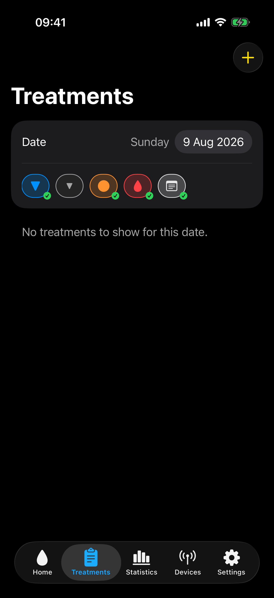

# Treatments

The Treatments tab displays locally stored treatments and supported treatment entries downloaded from Nightscout or CareLink.

## Browse treatments

Use the date selector to choose a day. Use the filter to show the required treatment types. Select a row to view or edit it when editing is allowed.

The list can show insulin, carbohydrates, exercise, blood glucose checks, basal entries, site changes, sensor starts, pump battery changes, and notes. CareLink automatic basal deliveries can also appear when CareLink is the selected treatment source. You can add insulin, carbohydrates, exercise, a blood glucose check, or a note from xDrip4iOS.

The filter choices are saved. If a treatment appears to be missing, check the selected date and enable its treatment type in the filter.

On wider iPad windows, the date and filter controls appear beside the treatment list. The available treatment types and editing rules are unchanged.

## Add a treatment

1. Select the add button.
2. Select the treatment type.
3. Confirm the date and time.
4. Enter the value when the selected type requires one.
5. Add an optional note.
6. Select **Save**.

Use the unit shown beside the value. Insulin and carbohydrate entries do not use the glucose unit.

- **Insulin** records an insulin amount in units.
- **Carbohydrates** records an amount in grams.
- **Exercise** records a duration in minutes.
- **Blood Glucose Check** records a meter value in the selected glucose unit.
- **Note** records text without requiring a numeric value.

The date and time can be changed before saving. The optional note remains attached to that treatment.

## Edit or delete a treatment

Select a treatment to open it. Change the available fields and save, or select the delete control. A swipe action can also delete an eligible row.

Insulin, carbohydrates, exercise, blood glucose checks, and notes can be edited. Basal, automatic basal, site change, sensor start, and pump battery entries are read-only because they describe events imported from another system.

!!! warning
    Deleting a treatment cannot be undone in xDrip4iOS. If Nightscout synchronisation is enabled, a local change can also be uploaded or reflected in Nightscout.

## Nightscout synchronisation

When Nightscout is configured, xDrip4iOS can synchronise treatments. A treatment can include information about who entered it. Avoid creating the same event in several apps unless you understand how your Nightscout setup prevents duplicates.

CareLink treatments are imported when **Pump & Treatments** is set to **Automatic** or `CareLink` and CareLink is the active glucose source. Changing the **Automatic Basal** display between **Basal Pulses** and **Temp Basals** changes the chart only. It does not change the stored delivered insulin.
